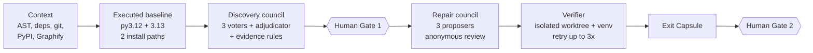

# PR Analyser

**AI that shows its evidence.** An open-weight, local-first agent that checks incoming changes and repairs Python dependency problems, then proves every claim by running real tests.

Most tools say "this version is old". PR Analyser finds problems that only appear when the code runs, tries fixes in isolation, verifies them with real tests, and hands a human a ready-to-review package. Every statement it makes is labelled by how it is known.

Tested on [LinkWatch](https://github.com/rishrek/LinkWatch), a Python CLI that checks website uptime.

---

## Three kinds of truth

Every claim in every report carries one label:

| Label | Meaning | Examples |
|---|---|---|
| **OBSERVED** | Read directly from the code, git history or registries | Imports, pinned versions, PyPI release dates, usage sites |
| **VERIFIED** | Proven by actually running something | Install, `uv pip check`, import smoke test, CLI `--help`, pytest, acceptance suite |
| **AI** | An opinion from the language model | Council votes, proposed patches, reviewer scores |

**Rule: AI never overrides VERIFIED.** Deterministic rules outrank AI consensus. A dismissal is overridden when executed failure evidence exists, and a claim of a runtime problem is rejected unless a run backs it.

---

## Two modes

### Maintenance mode (implemented)
Finds and fixes dependency rot in a repository: stale pins, manifests that disagree, removed APIs, silent behaviour changes.

### Review mode (implemented)
Checks an incoming change (base vs head) instead of the whole repository:

```bash
python -m resilience_agent --repo PATH review --base main --head my-branch --pr-description pr.md
```

- **Base vs head on the same verifier.** Both commits are checked out in separate git worktrees and run through the same checks. A check that passes on base and fails on head is a `REGRESSION` (VERIFIED).
- **Blast radius.** Changed lines are mapped to functions and classes, then the call graph is walked backwards (stdlib AST plus Graphify) to find callers, entry points and tests (OBSERVED). Per-test coverage (`--cov-context=test`) records which tests really execute the change (VERIFIED). Anything only one source found is marked *uncertain*, and the report gives the share of affected functions that any test executes.
- **Only affected tests run** on both sides, unless you pass `--full-suite` or the diff touches test or packaging config.
- **Structural checks (no AI).** Public API breaks via [griffe](https://mkdocstrings.github.io/griffe/) (removed or renamed objects, moved parameters, changed defaults), new import cycles, optional layer rules in `pr-analyser.toml`, entry-point, dependency and undeclared-import changes.
- **Behaviour diff.** For pure functions in the blast radius, inputs recorded from base's own tests are replayed on base and head and the outputs compared (VERIFIED). Optional AI-written tests (`--gen-tests N`) live only in `.resilience/generated_tests/` and count only if they pass on base first.
- **AI review of intent.** With a PR description, one model call compares what the PR claims with what the diff does (AI). It can never change the verdict.
- **Verdict:** `SAFE`, `REGRESSION_FOUND`, `FIXED`, `NEEDS_HUMAN`, `UNVERIFIABLE` (for example, no test executes the changed code) or, in maintenance mode, `NO_VERIFIED_SOLUTION`.

Review mode reuses the maintenance context engine, verifier, scanners and capsule format. The Streamlit dashboard has a Review tab.

---

## How it works



1. **Context.** Reads the repo with AST parsing, dependency files, git history, PyPI metadata and a Graphify knowledge graph. DeepWiki and Google Code Wiki context are optional.
2. **Baseline.** Runs the project as it stands, on Python 3.12 and 3.13 through both `requirements.txt` and `pyproject.toml`. This is VERIFIED evidence.
3. **Discovery council.** Deterministic detectors build candidate issues with numbered evidence. Three voters see the same packet and never each other's output: *Discovery* (recall), *Skeptic* (precision) and *Evidence* (proof). An adjudicator consolidates, then deterministic rules have the final word.
4. **Human Gate 1.** A person approves the issue and its scope. Nothing is repaired before this.
5. **Repair council.** Three proposers (minimal, migration, alternative) each return exact find/replace edits in an isolated git worktree. Candidates review each other anonymously, and ranking is deterministic.
6. **Verifier.** Install, `uv pip check`, import of every module, CLI `--help`, the project's pytest suite and an independent acceptance suite that candidates cannot edit. On failure the logs go back to the proposer, up to 3 attempts, otherwise `NO_VERIFIED_SOLUTION`.
7. **Exit Capsule and Human Gate 2.** A person approves publication. Nothing is pushed unless `RA_ALLOW_PUBLISH=1` is set.

---

## Key features

**Executed evidence, not guesses.** The baseline run exposes problems static tools miss, such as an install path that silently resolves a different major version.

**An AI council that is held to the evidence.** Three voters with different jobs, an adjudicator, and rules that make sure cited evidence exists and runtime claims have a run behind them.

**Competing repairs with anonymous review.** Reviewers see other candidates under random labels and score nine criteria. Reviewer and proposer weights change only when the verifier confirms or refutes a verdict.

**A decision log, not just a history.** The Exit Capsule records what was done and what was not:

- every candidate, including **rejected ones and the reason each lost** (validation problems, review defects, regressions)
- the council votes, disagreements and rule overrides
- **human decisions**: approvals, scope choices and maintainer guidance, labelled HUMAN
- ranking and weight history, tests before and after, remaining risks and gaps
- rollback steps and reproduction commands

Within a run, a patch identical to one that already failed is rejected and never ranked, and the proposer is told "THIS FAILED, do not repeat it".

**Decision log across runs.** Every repair and review writes `.resilience/history/<issue>/<entry>.json` plus a Markdown summary. Each reason must point at a real artifact (a verifier result, a saved checker output or a human approval row), otherwise the entry is refused. AI text is only allowed in a separate, labelled `ai_summary`, and secrets are scrubbed before saving. On the next repair, approaches that failed are passed to the proposers and reviewers and identical patches are rejected. After `RA_HISTORY_MAX_AGE_DAYS` (default 30) they become "retest" instead of "skip".

**Safe by construction.** Allow-listed commands, no shell, timeouts, secrets scrubbed from the environment, patches confined to allowed files, and no ability to edit tests.

**Local and free to run.** Open-weight model on CPU through Ollama, with seed, temperature, tokens and raw model calls recorded for every call.

---

## Results on LinkWatch

Real runs on 17 Oct 2026. Logs and capsules are in [`demo/`](demo/).

| Step | Result |
|---|---|
| Baseline (VERIFIED) | Fails in all 4 environments (Python 3.12 and 3.13, both install paths). Jinja2 2.11.3 cannot import `soft_unicode`, which was removed in MarkupSafe 2.1. |
| Hidden behaviour change (VERIFIED) | `pyproject.toml` resolves Pydantic 2.14.1 while `requirements.txt` pins 1.10.13. Pydantic v2 silently ignores the v1 `anystr_strip_whitespace` setting, so site names and URLs stop being stripped. The acceptance test fails only on the `pyproject.toml` path. **Only execution caught this.** |
| Static analysis | 15 modules, 14 dependencies, 169 facts, 13 candidate issues. |
| Discovery council | The voters disagreed (Discovery said real issue, Skeptic and Evidence dissented). The evidence rules kept Jinja2 and Pydantic as supported because executed failures backed them, and downgraded two weak issues to needs-investigation. |
| `RA-jinja2` | **VERIFIED_RESOLUTION** on attempt 3: `Jinja2==3.1.6` in both manifests. 18 checks and tests fixed, 0 regressions ([patch](demo/jinja2-capsule/selected.patch), [capsule](demo/jinja2-capsule/capsule.md)). |
| `RA-pydantic` | **NO_VERIFIED_SOLUTION** in runs 2, 5 and 7. The 3B model only re-pinned Pydantic and never migrated `linkwatch/config.py`; the verifier blocked each candidate for 2 regressions ([run 5 capsule](demo/run5-capsule/capsule.md)). The agent reported failure instead of presenting an unproven patch. |

**Review mode on LinkWatch (17 Oct 2026).** On a throwaway branch of a fresh clone, the public `cache.load_results` was renamed to `read_results`, the CLI caller was updated and the tests were not, under a PR description claiming "no behaviour change". Result: **REGRESSION_FOUND** (VERIFIED: `test_cache_round_trip` passes on base and fails on head in all 4 environments). The blast radius named the 3 changed symbols, the CLI entry point and 2 affected tests, both confirmed by static analysis and per-test coverage. Only those 2 test files ran on each side. The API check reported `load_results` as removed and "likely renamed to `read_results`" (OBSERVED). qwen2.5-coder:3b flagged the "no behaviour change" claim as a mismatch (AI). With cached venvs the whole run took 147 s on the i5 laptop.

Failures that improved the agent: the 3B model truncated `pyproject.toml` (now exact find/replace edits with parser and truncation guards), one generation ran over 15 minutes (now output caps and hard timeouts), early candidates only aligned version pins and tests caught two regressions, and an identical failed patch was resubmitted (now rejected as a duplicate).

Speed on an i5 with 16 GB RAM and no GPU: about 2.5 minutes per council vote and about 2 minutes per verification run.

---

## Technology stack

| Technology | Purpose |
|---|---|
| Python 3.12+ | Core logic |
| LangGraph 1.x | Workflow orchestration with SQLite checkpoints and `interrupt()` human gates |
| Ollama + Qwen2.5-Coder 3B (7B optional) | Local voters, proposers and reviewers |
| Pydantic 2 | Structured, schema-constrained model output and logs |
| SQLite | Facts, issues, votes, candidates, verifications, approvals |
| uv, git worktrees, pytest | Isolated environments, patches and verification |
| Graphify | Code relationship graph |
| DeepWiki MCP | Optional repository context |
| Streamlit | Dashboard |
| GitHub Actions | CI |

**Model licences:** Qwen2.5-Coder-3B is under the Qwen Research License (research and non-commercial use). The 7B model is Apache-2.0. Set `RA_MODEL` to switch.

---

## Getting started

Prerequisites: Python 3.12+, Git, [uv](https://docs.astral.sh/uv/), [Ollama](https://ollama.com) and Python 3.12 and 3.13 interpreters for the verifier.

```bash


uv python install 3.12 3.13
uv venv --python 3.12 .venv-agent
uv pip install --python .venv-agent/bin/python -r requirements-dashboard.txt   # Windows: .venv-agent\Scripts\python.exe
ollama pull qwen2.5-coder:3b
source .venv-agent/bin/activate                                                # Windows: .venv-agent\Scripts\activate
```

Run the pipeline:

```bash
python -m resilience_agent doctor                  # real probes: Ollama, Graphify, Docker, uv, Pythons
python -m resilience_agent scan                    # context + baseline + discovery council
python -m resilience_agent inspect RA-pydantic     # evidence, votes, disagreement
python -m resilience_agent approve RA-pydantic --scope pydantic,jinja2   # Human Gate 1
python -m resilience_agent repair RA-pydantic      # repair council + verification + capsule
python -m resilience_agent report RA-pydantic
python -m resilience_agent publish RA-pydantic     # Human Gate 2
python -m resilience_agent review --base main --head my-branch   # review mode
```

Dashboard and tests:

```bash
streamlit run resilience_agent/dashboard.py
python -m pytest tests_agent -q                    # fake provider, no model needed
```

Settings are environment variables prefixed `RA_` (see `.env.example`). Full architecture, councils, verification design and capsule spec are in [`docs/agent/GUIDE.md`](docs/agent/GUIDE.md).

---

## Limitations

- **No Docker sandbox yet.** Isolation is a git worktree plus a virtualenv, which is reduced-trust local mode and not a security sandbox. Do not run it on untrusted repositories.
- **Tested on one repository.** The results above are from LinkWatch only, and the independent acceptance suite exists only for LinkWatch. Other repos get the generic checks.
- **Small-model quality varies.** The 3B model failed the Pydantic migration. The 7B model works but was about 12 minutes per call on our CPU.
- **Proof is only as good as the tests.** A passing run is evidence, not a guarantee. Gaps in test coverage are gaps in verification.
- **Detection gaps.** Poetry and `setup.py` dependency lists are not parsed, and dynamic imports are not detected.
- **Context sources.** LinkWatch is not indexed in DeepWiki, and Google Code Wiki works only through manual import.
- **Review mode is static plus test-driven.** The call graph is name-based: dynamic dispatch, `getattr` and callbacks are missed, which is why coverage contexts are merged in and single-source items are marked uncertain. Behaviour replay only covers pure module-level functions whose arguments the existing tests pass and that can be pickled.
- **Layer rules** use a small `pr-analyser.toml` format (`[[forbid]] source/target`), not import-linter contracts. They are read from the base commit so a PR cannot relax its own rules.

---

## Roadmap

"Built" means implemented and covered by tests in `tests_agent/` (fake model provider, real git, venvs and pytest). The last column says where it has run for real.

| Feature | Status | Evidence |
|---|---|---|
| Maintenance mode (scan, councils, repair, verifier, two human gates) | Built | LinkWatch runs in `demo/` |
| Review mode: base vs head on the same verifier, `REGRESSION` detection | Built | Fixture repos + LinkWatch end-to-end run (below) |
| Blast radius: static call graph + Graphify + per-test coverage, uncertain marking, coverage % | Built | Fixture repos + LinkWatch run |
| Running only affected tests (`--full-suite` to opt out) | Built | Fixture repos + LinkWatch run |
| Structural checks: griffe API diff, likely renames, new import cycles, layer rules, packaging | Built | Fixture repos (rename, changed default, cycle, layer rule) + LinkWatch run |
| Decision log with artifact-checked reasons, secret scrubbing, cross-run memory, expiry | Built | Unit tests + fake-provider repair flow; not yet exercised across two real model repairs |
| Verdicts and capsule update (`capsule.md` + `capsule.json`) | Built | Fixture repos + LinkWatch run |
| Differential behaviour testing (recorded inputs replayed on base and head) | Built | Fixture repo; on LinkWatch the blast radius had no pure function, so nothing was replayed |
| AI-generated tests in `.resilience/generated_tests/` (must pass on base) | In progress | Works with the fake provider; not yet shown with the real 3B model |
| AI review of intent (one call, cannot change the verdict) | Built | Fake provider + one real qwen2.5-coder:3b run on LinkWatch |
| Dashboard Review tab | Built | Headless Streamlit AppTest render of the LinkWatch review |
| import-linter contracts | Planned | A minimal `pr-analyser.toml` rule format is used instead |
| Run on 5 to 10 more Python repos with a precision / recall / time scoreboard | Planned | |
| Council ablation: one prompt vs three voters vs three voters plus adjudicator | Planned | |
| Docker isolation with network-off test runs | Planned | |
| OSV security advisories, transitive dependencies | Planned | |
| Deterministic migration recipes (e.g. Pydantic v1 to v2) | Planned | |
| GitHub Action that runs review mode on PRs and attaches the capsule | Planned | |

---

## Links


- Target repo: [github.com/rishrek/LinkWatch](https://github.com/rishrek/LinkWatch)
- Agent Skills spec: [agentskills.io/specification](https://agentskills.io/specification)
- Inspiration for the anonymous review council: [github.com/karpathy/llm-council](https://github.com/karpathy/llm-council)

Licence: MIT.
